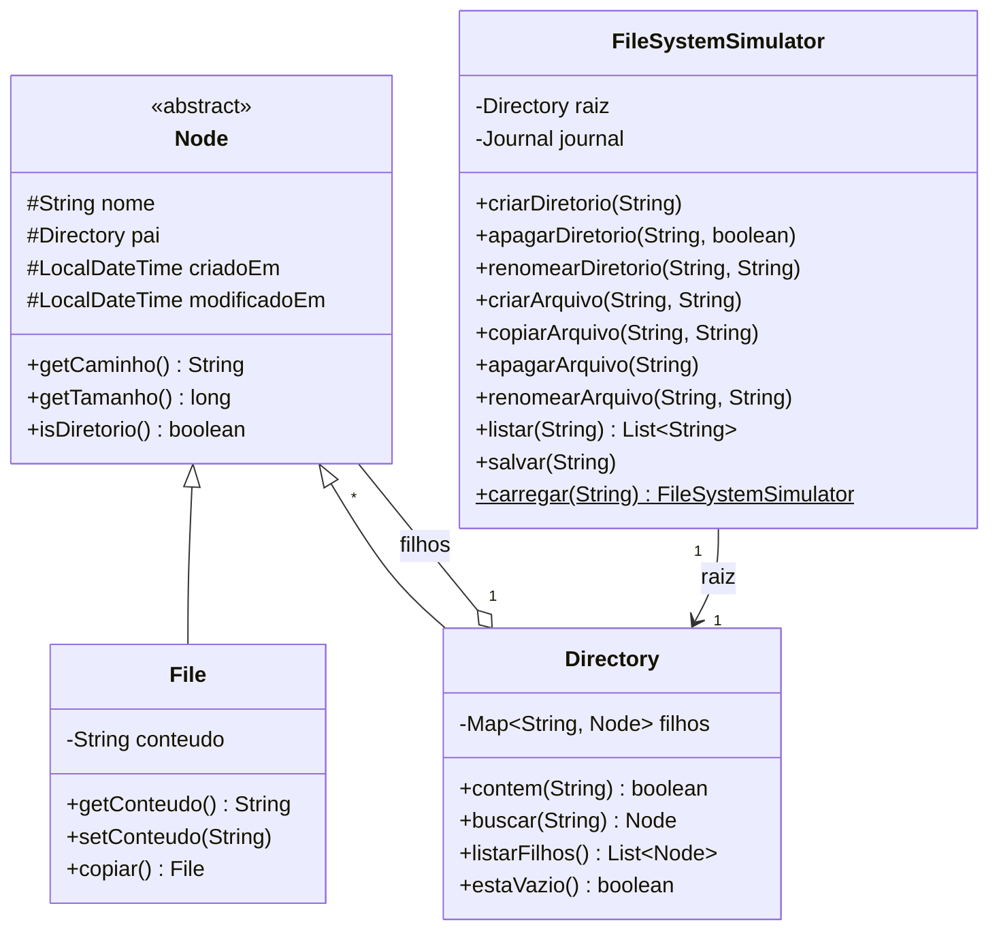

# Simulador de Sistema de Arquivos com Journaling (Java)

> **Trechos da Pessoa A**: Parte 1 (Introdução a sistemas de arquivos) e Parte 2 (Estruturas de dados).
> O tópico de *Journaling* dessas duas partes fica com a Pessoa B; há marcadores `<!-- PESSOA B -->` indicando onde encaixar.

---

## Parte 1: Introdução ao Sistema de Arquivos com Journaling

### 1.1 O que é um sistema de arquivos

Um **sistema de arquivos** (*file system*) é o componente do sistema operacional responsável por organizar, armazenar, nomear e recuperar dados em dispositivos de armazenamento, como HDs, SSDs e pendrives. Sem ele, o disco seria apenas uma sequência de blocos sem significado para o usuário.

Os dois conceitos centrais são:

- **Arquivo**: unidade lógica de armazenamento, que reúne dados sob um nome e possui metadados (tamanho, datas de criação e modificação, permissões etc.).
- **Diretório**: estrutura que agrupa arquivos e outros diretórios, formando uma **hierarquia em árvore** a partir de um diretório raiz (`/`).

Exemplos reais: FAT32, NTFS, ext4, APFS e XFS.

### 1.2 Importância

O sistema de arquivos é fundamental porque:

1. **Abstrai o hardware**: o usuário e os programas trabalham com nomes e pastas, e não com endereços de blocos físicos.
2. **Organiza os dados** de forma hierárquica, facilitando localizar e gerenciar informações.
3. **Controla o acesso**, com permissões e proteção de dados.
4. **Gerencia o espaço em disco**: aloca e libera blocos conforme arquivos são criados, copiados e apagados.
5. **Garante a integridade** dos dados mesmo diante de falhas, papel em que entra o journaling.

### 1.3 Operações básicas

As operações implementadas neste simulador correspondem a comandos clássicos de um sistema operacional:

| Operação | Comando equivalente (Unix) |
|---|---|
| Copiar arquivos | `cp` |
| Apagar arquivos | `rm` |
| Renomear arquivos | `mv` |
| Criar diretórios | `mkdir` |
| Apagar diretórios | `rmdir` |
| Renomear diretórios | `mv` |
| Listar arquivos de um diretório | `ls` |

### 1.4 Conceito de journaling

<!-- PESSOA B: inserir aqui o tópico de Journaling (propósito, funcionamento e tipos: write-ahead logging, log-structured etc.) -->

---

## Parte 2: Arquitetura do Simulador

### 2.1 Estruturas de dados

O sistema de arquivos é representado como uma **árvore** em memória, usando orientação a objetos. Todo elemento da árvore é um `Node`; arquivos e diretórios são especializações dele.



#### Classe `Node`

Classe abstrata com o que arquivos e diretórios têm em comum: **nome**, referência ao **diretório pai**, datas de **criação** e **modificação**. O método `getCaminho()` sobe pelos pais até a raiz e monta o caminho absoluto (ex.: `/docs/notas.txt`).

#### Classe `File`

Representa um arquivo. Guarda o **conteúdo como texto** (`String`) e calcula o tamanho em bytes (UTF-8). O método `copiar()` gera uma cópia independente, usada na operação de cópia.

#### Classe `Directory`

Representa um diretório. Seus filhos ficam em um `TreeMap<String, Node>`, que traz duas vantagens:

- **Busca por nome rápida** (`O(log n)`), útil para resolver caminhos e detectar nomes duplicados.
- **Listagem ordenada** por nome, sem precisar ordenar manualmente.

O tamanho de um diretório é a soma recursiva do tamanho de seus filhos.

#### Classe `FileSystemSimulator`

É a classe principal. Mantém a **raiz** da árvore e implementa as operações. Pontos de design:

- **Caminhos absolutos** a partir de `/`, com normalização de `.` e `..`.
- **Validação antes de alterar**: nome vazio, nome com `/`, nome duplicado, caminho inexistente, tipo errado (arquivo no lugar de diretório e vice-versa), apagar diretório não vazio e alterar a raiz geram um `FsException` com mensagem clara.
- **Cópia sem sobrescrever**: se o destino for um diretório existente, a cópia mantém o nome original; senão, o último trecho do destino vira o nome da cópia.
- **Remoção de diretório**: por padrão só remove diretório vazio; existe o modo recursivo.

#### Persistência: o arquivo que simula o sistema de arquivos

O sistema inteiro (a árvore de `Directory` e `File`) é gravado em **um único arquivo** (ex.: `data/meu.fs`) por **serialização Java** (`ObjectOutputStream`). Os métodos são:

| Método | Função |
|---|---|
| `FileSystemSimulator.criarNovo(caminho)` | cria um sistema vazio e grava o arquivo |
| `salvar(caminho)` | grava o estado atual no arquivo |
| `FileSystemSimulator.carregar(caminho)` | recarrega o sistema salvo |

Como `Node`, `File`, `Directory` e `FileSystemSimulator` implementam `Serializable`, a árvore completa é salva de uma só vez. O `Journal` é marcado como `transient`, pois o log é gerenciado à parte.

### 2.2 Ponto de integração com o Journaling

Cada operação que **altera** o sistema passa por um mesmo fluxo interno:

```
validar  ->  journal.registrar(tipo, parametros)  ->  executar a mudança  ->  journal.confirmar(id)
```

Se nenhum `Journal` estiver plugado, a operação apenas executa. Os tipos de operação enviados ao log são: `MKDIR`, `RMDIR`, `RMDIR_R`, `RENAME_DIR`, `CREATE_FILE`, `COPY`, `DELETE_FILE` e `RENAME_FILE`.

<!-- PESSOA B: inserir aqui a explicação da estrutura do log e das operações registradas -->
