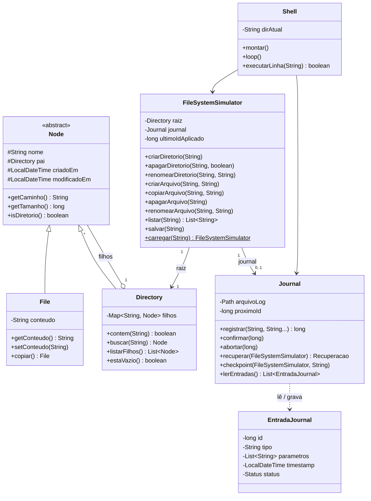
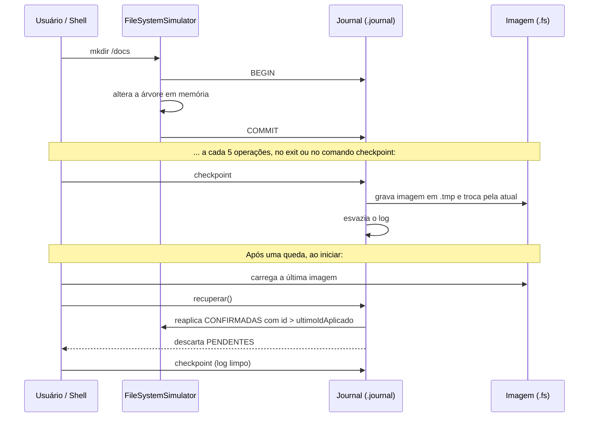

# Simulador de Sistema de Arquivos com Journaling (Java)

**Repositório no GitHub:** https://github.com/Soriedem76/TrabalhoAv3-SistemaOperacional

**Disciplina:** Sistemas Operacionais · **Trabalho AV3** · **Dupla:** _Nome da Pessoa A_ e _Nome da Pessoa B_

---

## Resumo

Este trabalho apresenta o desenvolvimento de um simulador de sistema de arquivos em Java. O simulador mantém uma árvore de diretórios e arquivos gravada em um único arquivo do disco real e implementa as operações básicas de um SO: copiar, apagar e renomear arquivos; criar, apagar e renomear diretórios; e listar o conteúdo de um diretório. Para proteger a integridade dos dados, todas as alterações passam por um **journal** com *write-ahead logging*, que permite recuperar o sistema depois de uma queda. O simulador pode ser usado por chamadas de método (um comando por execução) ou por um **shell interativo** (modo avançado).

## Introdução

O gerenciamento eficiente de arquivos é crucial para o funcionamento dos sistemas operacionais. Por isso, entender como um sistema de arquivos é montado e organizado é a base para compreender os sistemas operacionais. O simulador torna visíveis conceitos que normalmente ficam escondidos dentro do kernel: a hierarquia de diretórios, a validação das operações, a persistência em disco e, principalmente, o journaling.

## Objetivo

Desenvolver em Java um simulador de sistema de arquivos com as funcionalidades básicas de manipulação de arquivos e diretórios e com suporte a journaling para garantir a integridade dos dados.

## Metodologia

O simulador foi desenvolvido em Java. Ele recebe chamadas de métodos com os devidos parâmetros, e cada método implementa um comando correspondente aos de um SO. O programa executa cada funcionalidade e exibe o resultado na tela quando necessário. Os comandos podem ser enviados de três formas:

1. **Chamadas de método** direto no código (ex.: `fs.criarDiretorio("/docs")`, veja `DemoNucleo`).
2. **Um comando por execução** pela linha de comando (ex.: `java -cp out simulador.Main mkdir /docs`).
3. **Modo avançado (shell)**: um laço de comandos `ls`, `mkdir`, `cp`, `rm`, `mv`, `rmdir`... sobre um disco com journaling.

---

## Parte 1: Introdução ao Sistema de Arquivos com Journaling

### 1.1 O que é um sistema de arquivos

Um **sistema de arquivos** (*file system*) é o componente do sistema operacional responsável por organizar, armazenar, nomear e recuperar dados em dispositivos de armazenamento, como HDs, SSDs e pendrives. Sem ele, o disco seria apenas uma sequência de blocos sem significado para o usuário.

Os dois conceitos centrais são:

- **Arquivo**: unidade lógica de armazenamento, que reúne dados sob um nome e possui metadados (tamanho, datas de criação e modificação, permissões etc.).
- **Diretório**: estrutura que agrupa arquivos e outros diretórios, formando uma **hierarquia em árvore** a partir de um diretório raiz (`/`).

Exemplos reais: FAT32, NTFS, ext4, APFS e XFS.

### 1.2 Importância

O sistema de arquivos é fundamental porque:

1. **Abstrai o hardware**: o usuário e os programas trabalham com nomes e pastas, e não com endereços de blocos físicos.
2. **Organiza os dados** de forma hierárquica, facilitando localizar e gerenciar informações.
3. **Controla o acesso**, com permissões e proteção de dados.
4. **Gerencia o espaço em disco**: aloca e libera blocos conforme arquivos são criados, copiados e apagados.
5. **Garante a integridade** dos dados mesmo diante de falhas, papel em que entra o journaling.

### 1.3 Operações básicas

As operações implementadas neste simulador correspondem a comandos clássicos de um sistema operacional:

| Operação | Comando equivalente (Unix) | Comando no shell do simulador |
|---|---|---|
| Copiar arquivos | `cp` | `cp <origem> <destino>` |
| Apagar arquivos | `rm` | `rm <arquivo>` |
| Renomear arquivos | `mv` | `mv <arquivo> <novo-nome>` |
| Criar diretórios | `mkdir` | `mkdir <dir>` |
| Apagar diretórios | `rmdir` | `rmdir [-r] <dir>` |
| Renomear diretórios | `mv` | `mv <dir> <novo-nome>` |
| Listar arquivos de um diretório | `ls` | `ls [dir]` |

### 1.4 Journaling: propósito

Uma única operação de alto nível, como apagar um arquivo, exige **várias escritas** no disco: remover a entrada do diretório, liberar o inode e marcar os blocos como livres no mapa de alocação. Se a energia acabar no meio desse processo, o disco fica **inconsistente**: um bloco pode ficar marcado como usado sem pertencer a ninguém, ou um diretório pode apontar para um inode já liberado.

Sem journaling, a única saída é varrer o disco inteiro na inicialização (o `fsck` no Linux, o `chkdsk` no Windows), o que pode levar horas em discos grandes e nem sempre recupera tudo.

O **journaling** resolve isso com uma ideia simples: **antes de alterar as estruturas do sistema de arquivos, o SO anota em um log (o *journal*) o que vai fazer.** Depois de uma queda, basta ler esse log, que é pequeno, para saber quais operações estavam em andamento e deixar o sistema consistente em segundos. Cada operação vira uma **transação atômica**: ou acontece por completo, ou não acontece.

### 1.5 Journaling: funcionamento

O ciclo de uma transação em um sistema de arquivos com journaling é:

1. **Registro (*log write*)**: a descrição da operação é gravada no journal, e o SO espera essa gravação chegar fisicamente ao disco.
2. **Commit**: um registro de confirmação é gravado no journal. A partir daqui, a operação é considerada válida mesmo que o sistema caia.
3. **Aplicação (*checkpoint*)**: as alterações são escritas nos locais definitivos do disco.
4. **Liberação**: as entradas já aplicadas são removidas do journal, liberando espaço.

Na **recuperação**, depois de uma queda:

- Transações **com commit** são **refeitas (*redo*)**, pois podem não ter chegado aos locais definitivos.
- Transações **sem commit** são **descartadas**, como se nunca tivessem começado.

### 1.6 Tipos de journaling

| Tipo | Como funciona | Exemplos |
|---|---|---|
| **Write-ahead logging (WAL)** | A regra é: *nada é alterado no lugar definitivo antes de a descrição da mudança estar no log*. O log é a fonte da verdade durante a recuperação, que pode refazer (*redo*) e/ou desfazer (*undo*) operações. | ext3/ext4, NTFS, XFS, JFS, bancos de dados (PostgreSQL, SQLite em modo WAL) |
| **Journaling de metadados** (*ordered* / *writeback*) | Só a estrutura (diretórios, inodes, mapas de blocos) vai para o journal; o conteúdo dos arquivos é escrito direto. É mais rápido e garante a consistência da estrutura, mas o conteúdo de um arquivo pode ficar desatualizado. No modo *ordered*, os dados são gravados antes do commit dos metadados. | ext4 (padrão `data=ordered`), NTFS, XFS |
| **Journaling completo** (*data journaling*) | Metadados **e** dados passam pelo journal. É o mais seguro, mas tudo é escrito duas vezes. | ext3/ext4 com `data=journal` |
| **Log-structured** | Não existe um journal separado: **o próprio disco é o log**. Toda escrita é acrescentada ao final, e nada é sobrescrito no lugar. Um *coletor de lixo* (*cleaner*) recupera o espaço das versões antigas. A recuperação lê o fim do log até o último ponto consistente. | LFS (Sprite), F2FS (flash), NILFS2, conceitos usados em SSDs |
| **Copy-on-write (COW)** | Uma variação próxima: os blocos alterados são escritos em lugar novo e, no fim, um único ponteiro raiz é trocado atomicamente. | ZFS, Btrfs, APFS |

**Neste simulador** foi usado **write-ahead logging com recuperação por redo** e journaling da **operação lógica completa**: cada comando é registrado com todos os seus parâmetros, inclusive o conteúdo de um arquivo criado.

---

## Parte 2: Arquitetura do Simulador

### 2.1 Estruturas de dados

O sistema de arquivos é representado como uma **árvore** em memória, usando orientação a objetos. Todo elemento da árvore é um `Node`; arquivos e diretórios são especializações dele.



#### Classe `Node`

Classe abstrata com o que arquivos e diretórios têm em comum: **nome**, referência ao **diretório pai**, datas de **criação** e **modificação**. O método `getCaminho()` sobe pelos pais até a raiz e monta o caminho absoluto (ex.: `/docs/notas.txt`).

#### Classe `File`

Representa um arquivo. Guarda o **conteúdo como texto** (`String`) e calcula o tamanho em bytes (UTF-8). O método `copiar()` gera uma cópia independente, usada na operação de cópia.

#### Classe `Directory`

Representa um diretório. Seus filhos ficam em um `TreeMap<String, Node>`, que traz duas vantagens:

- **Busca por nome rápida** (`O(log n)`), útil para resolver caminhos e detectar nomes duplicados.
- **Listagem ordenada** por nome, sem precisar ordenar manualmente.

O tamanho de um diretório é a soma recursiva do tamanho de seus filhos.

#### Classe `FileSystemSimulator`

É a classe principal. Mantém a **raiz** da árvore e implementa as operações. Pontos de design:

- **Caminhos absolutos** a partir de `/`, com normalização de `.` e `..`.
- **Validação antes de alterar**: nome vazio, nome com `/`, nome duplicado, caminho inexistente, tipo errado (arquivo no lugar de diretório e vice-versa), apagar diretório não vazio e alterar a raiz geram um `FsException` com mensagem clara.
- **Cópia sem sobrescrever**: se o destino for um diretório existente, a cópia mantém o nome original; senão, o último trecho do destino vira o nome da cópia.
- **Remoção de diretório**: por padrão só remove diretório vazio; existe o modo recursivo.

#### Persistência: o arquivo que simula o sistema de arquivos

O sistema inteiro (a árvore de `Directory` e `File`) é gravado em **um único arquivo** (ex.: `data/disco.fs`) por **serialização Java** (`ObjectOutputStream`). Os métodos são:

| Método | Função |
|---|---|
| `FileSystemSimulator.criarNovo(caminho)` | cria um sistema vazio e grava o arquivo |
| `salvar(caminho)` | grava o estado atual no arquivo |
| `FileSystemSimulator.carregar(caminho)` | recarrega o sistema salvo |

Como `Node`, `File`, `Directory` e `FileSystemSimulator` implementam `Serializable`, a árvore completa é salva de uma só vez. O `Journal` é marcado como `transient`, pois o log é gerenciado à parte, em outro arquivo (`data/disco.fs.journal`).

### 2.2 Ponto de integração com o Journaling

Cada operação que **altera** o sistema passa pelo mesmo fluxo interno, no método privado `executar` do `FileSystemSimulator`:

```
validar  ->  journal.registrar(tipo, parametros)  ->  executar a mudança  ->  journal.confirmar(id)
                    (BEGIN no disco)                   (árvore em memória)       (COMMIT no disco)
```

- A **validação vem primeiro**: uma operação inválida (ex.: nome duplicado) nem chega ao journal.
- Se a execução lançar um erro inesperado, a entrada é marcada com **`ABORT`**.
- Depois do commit, o campo `ultimoIdAplicado` do simulador recebe o ID da operação. Esse número é salvo **junto com a imagem**, então a imagem sabe até qual operação do log ela já contém.
- Sem `Journal` plugado (por exemplo, durante o replay da recuperação), a operação apenas executa.

### 2.3 Estrutura do log

O journal é um **arquivo texto** separado da imagem (`<disco>.fs.journal`), usado **somente para acréscimos** (*append-only*). Cada linha é um registro, e cada gravação é feita com `StandardOpenOption.SYNC`, ou seja, o método só retorna depois que o dado está fisicamente no disco. É isso que garante o *write-ahead*.

```
BEGIN|id|timestamp|TIPO|parâmetro1|parâmetro2|#crc32
COMMIT|id|timestamp|#crc32
ABORT|id|timestamp|#crc32
```

| Campo | Significado |
|---|---|
| `BEGIN` / `COMMIT` / `ABORT` | Tipo do registro: início da operação, confirmação ou cancelamento |
| `id` | **ID da operação**, sequencial e crescente; liga o `COMMIT` ao seu `BEGIN` |
| `timestamp` | **Data e hora** do registro (ISO-8601) |
| `TIPO` | **Tipo da operação** (tabela abaixo) |
| `parâmetros` | **Parâmetros** necessários para refazer a operação |
| `#crc32` | Soma de verificação da linha; uma linha cortada no meio (queda durante a escrita) não confere e é ignorada |

Os caracteres especiais dentro dos parâmetros são escapados (`|` → `\p`, quebra de linha → `\n`, `\` → `\\`), para que cada registro ocupe sempre uma única linha.

O **status** de cada operação é obtido ao ler o log:

| Status | Situação no arquivo | O que a recuperação faz |
|---|---|---|
| `PENDENTE` | tem `BEGIN`, sem `COMMIT` | **descarta**: a operação foi interrompida e nunca chegou à imagem |
| `CONFIRMADA` | tem `BEGIN` e `COMMIT` | **reaplica** (*redo*), se ainda não estiver na imagem |
| `ABORTADA` | tem `BEGIN` e `ABORT` | ignora |

Exemplo real de um journal após o sistema cair no meio de uma cópia: as operações 1 e 2 foram confirmadas, e a 3 ficou pendente.

```
BEGIN|1|2026-11-26T13:50:14.772573100|MKDIR|/docs|#74317584
COMMIT|1|2026-11-26T13:50:14.785101300|#27ecf849
BEGIN|2|2026-11-26T13:50:14.793136700|CREATE_FILE|/docs/a.txt|Olá \p mundo|#b89eda19
COMMIT|2|2026-11-26T13:50:14.795803100|#76ec8c89
BEGIN|3|2026-11-26T13:50:14.800898400|COPY|/docs/a.txt|/docs/b.txt|#a22985ee
```

### 2.4 Operações registradas

| Tipo no log | Método do simulador | Parâmetros gravados |
|---|---|---|
| `MKDIR` | `criarDiretorio` | caminho |
| `RMDIR` | `apagarDiretorio` (só vazio) | caminho |
| `RMDIR_R` | `apagarDiretorio` (recursivo) | caminho |
| `RENAME_DIR` | `renomearDiretorio` | caminho, novo nome |
| `CREATE_FILE` | `criarArquivo` | caminho, conteúdo |
| `COPY` | `copiarArquivo` | origem, destino |
| `DELETE_FILE` | `apagarArquivo` | caminho |
| `RENAME_FILE` | `renomearArquivo` | caminho, novo nome |

`listar` (`ls`) não altera o sistema e por isso não é registrada.

### 2.5 Checkpoint e recuperação



- **Checkpoint**: a imagem é gravada primeiro em `disco.fs.tmp` e depois movida por cima de `disco.fs`, então uma queda durante a gravação não destrói a imagem anterior. Só depois o log é esvaziado.
- **Idempotência**: se o sistema cair entre gravar a imagem e esvaziar o log, as operações continuam no journal. O `ultimoIdAplicado` salvo na imagem faz com que elas sejam **ignoradas**, e não reaplicadas em dobro.
- **Momento do checkpoint**: na inicialização (após a recuperação), a cada 5 operações confirmadas, no comando `checkpoint` e ao sair com `exit`.

---

## Parte 3: Implementação em Java

Todo o código está no pacote `simulador`, em `src/simulador/`.

| Classe | Responsabilidade |
|---|---|
| `Node` | Classe abstrata base da árvore: nome, pai, datas, caminho absoluto. |
| `File` | Arquivo: conteúdo textual, tamanho em bytes e cópia independente. |
| `Directory` | Diretório: filhos em `TreeMap`, adicionar, remover, renomear filho e tamanho recursivo. |
| `FileSystemSimulator` | Núcleo do simulador: as operações, as validações, a persistência por serialização e a integração com o journal (`executar`). |
| `FsException` | Exceção de operação inválida, com mensagem amigável. |
| `Journal` | Gerencia o log: `registrar` (BEGIN), `confirmar` (COMMIT), `abortar` (ABORT), `recuperar` (redo/descartar), `checkpoint` e a simulação de falhas. |
| `EntradaJournal` | Um registro do log: ID, tipo, parâmetros, timestamp e status (`PENDENTE`, `CONFIRMADA`, `ABORTADA`). |
| `Shell` | Modo avançado: interpreta comandos (`ls`, `cd`, `mkdir`, `cp`, `rm`, `mv`...), resolve caminhos relativos e dispara checkpoints. |
| `Main` | Ponto de entrada: abre o shell ou executa um único comando passado por argumento. |
| `TesteJournal` | Testes de execução, incluindo falhas simuladas no meio das operações. |
| `DemoNucleo` | Demonstração do núcleo por chamadas de método diretas. |

### 3.1 `FileSystemSimulator`

Expõe um método por operação: `copiarArquivo`, `apagarArquivo`, `renomearArquivo`, `criarDiretorio`, `apagarDiretorio`, `renomearDiretorio`, `listar` e também `criarArquivo` (necessário para ter o que copiar). Toda alteração chama o fluxo de journaling:

```java
private void executar(String tipo, Runnable acao, String... parametros) {
    if (journal == null) { acao.run(); return; }       // replay da recuperação
    long id = journal.registrar(tipo, parametros);     // 1. BEGIN gravado no disco (write-ahead)
    try {
        acao.run();                                    // 2. altera a árvore
    } catch (RuntimeException e) {
        journal.abortar(id);                           //    falhou: ABORT
        throw e;
    }
    journal.confirmar(id);                             // 3. COMMIT gravado no disco
    ultimoIdAplicado = id;
}
```

### 3.2 `File` e `Directory`

Formam a árvore (veja a seção 2.1). `Directory` mantém o vínculo **pai ↔ filhos**: ao adicionar um nó, define o pai dele; ao remover, desfaz o vínculo. Os métodos que alteram a árvore são *package-private*, ou seja, só o `FileSystemSimulator` consegue mudar a estrutura, e assim tudo passa pelo journal.

### 3.3 `Journal`

Principais métodos:

| Método | O que faz |
|---|---|
| `registrar(tipo, params...)` | Gera um ID, grava `BEGIN` com sync e retorna o ID. |
| `confirmar(id)` | Grava `COMMIT` com sync. |
| `abortar(id)` | Grava `ABORT`. |
| `lerEntradas()` | Lê o log, valida o CRC de cada linha e monta as entradas com seu status. |
| `recuperar(fs)` | Desliga o journal do simulador, reaplica as `CONFIRMADAS` posteriores ao checkpoint, descarta as `PENDENTES` e devolve um relatório. |
| `checkpoint(fs, imagem)` | Grava a imagem (via arquivo temporário) e esvazia o log. |
| `simularFalhaNaProximaOperacao()` | Faz a próxima operação executar em memória e "derrubar" o sistema antes do `COMMIT` (lança `Journal.FalhaSimulada`). |

O replay usa os próprios métodos públicos do simulador:

```java
switch (e.getTipo()) {
    case "MKDIR"       -> fs.criarDiretorio(e.param(0));
    case "RMDIR"       -> fs.apagarDiretorio(e.param(0), false);
    case "RMDIR_R"     -> fs.apagarDiretorio(e.param(0), true);
    case "RENAME_DIR"  -> fs.renomearDiretorio(e.param(0), e.param(1));
    case "CREATE_FILE" -> fs.criarArquivo(e.param(0), e.param(1));
    case "COPY"        -> fs.copiarArquivo(e.param(0), e.param(1));
    case "DELETE_FILE" -> fs.apagarArquivo(e.param(0));
    case "RENAME_FILE" -> fs.renomearArquivo(e.param(0), e.param(1));
}
```

### 3.4 `Shell` e `Main`

Ao iniciar, o `Shell` **monta o disco**: carrega a imagem (ou cria uma nova), abre o journal, executa a recuperação, mostra o relatório e faz um checkpoint. Em seguida entra no laço de comandos. Ele também mantém o **diretório atual** (`cd`, `pwd`), aceita **caminhos relativos** e textos entre **aspas**.

Dois comandos servem para demonstrar falhas:

- `crash <comando>`: executa o comando, mas o sistema "cai" depois de alterar a memória e **antes do COMMIT**. O processo termina na hora (`Runtime.halt`), sem salvar nada.
- `kill`: encerra o processo na hora, **sem checkpoint**. As operações confirmadas existem apenas no journal.

### 3.5 Testes (`TesteJournal`)

Os testes não usam bibliotecas externas. Para simular a queda, o objeto em memória é descartado sem salvar e o disco é montado de novo a partir dos arquivos, como aconteceria após reiniciar a máquina.

| # | Cenário | Resultado esperado |
|---|---|---|
| 1 | Operações normais | Cada operação gera `BEGIN` + `COMMIT`, em ordem |
| 2 | Queda **antes** do COMMIT | A operação pendente é **descartada**; as confirmadas são reaplicadas; os IDs continuam crescendo |
| 3 | Queda **depois** do COMMIT, sem checkpoint | As 6 operações são **reaplicadas** e a árvore fica idêntica à de antes da queda |
| 4 | Queda **durante** o checkpoint (imagem gravada, log não esvaziado) | Nada é reaplicado em dobro (graças ao `ultimoIdAplicado`) |
| 5 | Linha do log cortada no meio | O CRC detecta e a linha é ignorada |
| 6 | Conteúdo com `\|`, `\` e quebra de linha | O conteúdo sobrevive ao replay sem alteração |

---

## Parte 4: Instalação e funcionamento

### 4.1 Recursos utilizados

- **Java (JDK) 17 ou superior** (testado com o JDK 25). O código usa *records*, *switch expressions*, *text blocks* e *pattern matching* no `instanceof`.
- Somente a biblioteca padrão do Java: `java.nio.file` (arquivos e `SYNC`), `java.io` (serialização), `java.util.zip.CRC32` e `java.time`.
- Nenhuma dependência externa, Maven ou Gradle.

### 4.2 Estrutura do projeto

```
.
├── README.md
├── executar.bat          # compila e executa (Windows)
├── executar.sh           # compila e executa (Linux/macOS)
├── exemplos/
│   └── demo.txt          # roteiro de comandos para o shell
└── src/simulador/
    ├── Node.java  File.java  Directory.java  FsException.java
    ├── FileSystemSimulator.java
    ├── Journal.java  EntradaJournal.java
    ├── Shell.java  Main.java
    └── TesteJournal.java  DemoNucleo.java
```

Ao executar, é criada a pasta `data/` com o disco simulado (`disco.fs`) e o journal (`disco.fs.journal`).

### 4.3 Passo a passo

1. Instale o JDK 17+ e confira no terminal:
   ```
   java -version
   javac -version
   ```
2. Clone o repositório:
   ```
   git clone https://github.com/Soriedem76/TrabalhoAv3-SistemaOperacional.git
   cd TrabalhoAv3-SistemaOperacional
   ```
3. Compile:
   ```
   javac -encoding UTF-8 -d out src/simulador/*.java
   ```
   No PowerShell do Windows, se o curinga não funcionar, use `javac -encoding UTF-8 -d out (Get-ChildItem src\simulador\*.java)`.
4. Execute o **shell interativo**:
   ```
   java -cp out simulador.Main
   ```
   Ou use os scripts, que compilam e executam de uma vez: `executar.bat` (Windows) ou `./executar.sh` (Linux/macOS).
5. Rode os **testes de falha e recuperação**:
   ```
   java -cp out simulador.TesteJournal
   ```

> **Dica (Windows):** se os acentos aparecerem trocados, rode `chcp 65001` antes ou acrescente `-Dstdout.encoding=UTF-8` ao comando `java`. O `executar.bat` já faz isso.

### 4.4 Formas de uso

| Forma | Comando |
|---|---|
| Shell interativo | `java -cp out simulador.Main` |
| Shell com outro arquivo de disco | `java -cp out simulador.Main --disco data/outro.fs` |
| Um comando por execução | `java -cp out simulador.Main mkdir /docs` |
| Rodar um roteiro de comandos | `java -cp out simulador.Main --eco < exemplos/demo.txt` |
| Chamadas de método direto no código | `java -cp out simulador.DemoNucleo` |

### 4.5 Comandos do shell

| Comando | Descrição |
|---|---|
| `ls [dir]` | lista o conteúdo de um diretório |
| `cd <dir>` / `pwd` | muda / mostra o diretório atual |
| `tree [dir]` | mostra a árvore de diretórios |
| `mkdir <dir>` | cria diretório |
| `rmdir [-r] <dir>` | apaga diretório vazio (ou tudo, com `-r`) |
| `touch <arq> [texto]` | cria arquivo com o conteúdo informado (use aspas para textos com espaço) |
| `cat <arq>` | mostra o conteúdo de um arquivo |
| `cp <origem> <destino>` | copia arquivo (o destino pode ser um diretório ou um novo nome) |
| `rm <arq>` | apaga arquivo |
| `mv <caminho> <novo-nome>` | renomeia arquivo ou diretório |
| `journal` | mostra o log de operações desde o último checkpoint |
| `checkpoint` | grava a imagem do disco e esvazia o journal |
| `crash <comando>` | executa o comando e simula uma queda antes do COMMIT |
| `kill` | simula uma queda sem checkpoint |
| `help` / `exit` | ajuda / checkpoint e sair |

### 4.6 Exemplos de execução

#### Exemplo 1: uso normal do shell (`exemplos/demo.txt`)

```
=== Simulador de Sistema de Arquivos com Journaling ===
Disco novo criado: data/disco.fs
Journal limpo: o disco foi desmontado corretamente.
Digite 'help' para ver os comandos.
fs:/$ mkdir docs
ok
fs:/$ mkdir docs/trabalhos
ok
fs:/$ touch docs/notas.txt "Olá, sistema de arquivos!"
ok
fs:/$ cp docs/notas.txt docs/trabalhos
ok
fs:/$ cd docs
fs:/docs$ cp notas.txt backup.txt
ok
[checkpoint automático após 5 operações]
fs:/docs$ ls
[ARQ] backup.txt (26 bytes)
[ARQ] notas.txt (26 bytes)
[DIR] trabalhos
fs:/docs$ mv backup.txt notas-bkp.txt
ok
fs:/docs$ mv trabalhos entregas
ok
fs:/docs$ tree /
/
`-- docs/
    |-- entregas/
    |   `-- notas.txt (26 bytes)
    |-- notas-bkp.txt (26 bytes)
    `-- notas.txt (26 bytes)
fs:/docs$ cat entregas/notas.txt
Olá, sistema de arquivos!
fs:/docs$ rmdir /docs
Erro: Saia do diretório antes de apagá-lo.
fs:/docs$ rm notas-bkp.txt
ok
fs:/docs$ ls
[DIR] entregas
[ARQ] notas.txt (26 bytes)
fs:/docs$ journal
Journal: data\disco.fs.journal (3 entrada(s) desde o último checkpoint)
ID    TIMESTAMP           TIPO        STATUS      PARÂMETROS
#6    26/11/2026 13:48:55 RENAME_FILE CONFIRMADA  "/docs/backup.txt", "notas-bkp.txt"
#7    26/11/2026 13:48:55 RENAME_DIR  CONFIRMADA  "/docs/trabalhos", "entregas"
#8    26/11/2026 13:48:55 DELETE_FILE CONFIRMADA  "/docs/notas-bkp.txt"
fs:/docs$ exit
Checkpoint feito. Disco desmontado com segurança.
```

#### Exemplo 2: queda no meio de uma operação (antes do COMMIT)

```
fs:/$ mkdir /temp
ok
fs:/$ crash rm /docs/notas.txt
[falha armada: o sistema vai cair depois de executar e antes do COMMIT]
*** SISTEMA CAIU: Queda simulada após executar a operação #10 e antes do COMMIT.
*** O processo será encerrado SEM checkpoint. Inicie o simulador de novo para ver a recuperação.
```

Ao iniciar de novo, o journal recupera o sistema: o `mkdir /temp`, que foi confirmado, é **reaplicado**, e o `rm`, que não tinha COMMIT, é **descartado**. O arquivo continua existindo.

```
=== Simulador de Sistema de Arquivos com Journaling ===
Disco carregado: data/disco.fs
== Recuperação pelo journal ==
  REAPLICADA: #9    26/11/2026 13:49:45 MKDIR       CONFIRMADA  "/temp"
  DESCARTADA (sem COMMIT): #10   26/11/2026 13:49:45 DELETE_FILE PENDENTE    "/docs/notas.txt"
  Resumo: 1 reaplicada(s), 1 descartada(s), 0 já no checkpoint, 0 abortada(s), 0 linha(s) inválida(s).
Digite 'help' para ver os comandos.
fs:/$ ls /docs
[DIR] entregas
[ARQ] notas.txt (26 bytes)
```

#### Exemplo 3: queda depois dos COMMITs, sem checkpoint

```
fs:/$ mkdir /a
ok
fs:/$ mkdir /b
ok
fs:/$ journal
Journal: data\disco.fs.journal (2 entrada(s) desde o último checkpoint)
ID    TIMESTAMP           TIPO        STATUS      PARÂMETROS
#11   26/11/2026 13:49:47 MKDIR       CONFIRMADA  "/a"
#12   26/11/2026 13:49:47 MKDIR       CONFIRMADA  "/b"
fs:/$ kill
*** Queda simulada (kill): encerrando sem checkpoint. 2 operação(ões) confirmada(s) estão apenas no journal.
```

A imagem do disco não tinha `/a` nem `/b`, mas o journal tinha. Na inicialização, eles são **refeitos**:

```
=== Simulador de Sistema de Arquivos com Journaling ===
Disco carregado: data/disco.fs
== Recuperação pelo journal ==
  REAPLICADA: #11   26/11/2026 13:49:47 MKDIR       CONFIRMADA  "/a"
  REAPLICADA: #12   26/11/2026 13:49:47 MKDIR       CONFIRMADA  "/b"
  Resumo: 2 reaplicada(s), 0 descartada(s), 0 já no checkpoint, 0 abortada(s), 0 linha(s) inválida(s).
Digite 'help' para ver os comandos.
fs:/$ ls /
[DIR] a
[DIR] b
[DIR] docs
[DIR] temp
```

#### Exemplo 4: um comando por execução

```
> java -cp out simulador.Main touch /docs/x.txt "texto com espaço"
=== Simulador de Sistema de Arquivos com Journaling ===
Disco carregado: data/disco.fs
Journal limpo: o disco foi desmontado corretamente.
ok

> java -cp out simulador.Main cat /docs/x.txt
=== Simulador de Sistema de Arquivos com Journaling ===
Disco carregado: data/disco.fs
Journal limpo: o disco foi desmontado corretamente.
texto com espaço
```

#### Exemplo 5: testes automatizados

```
> java -cp out simulador.TesteJournal
-> 1. Operações normais geram BEGIN + COMMIT (write-ahead)
     #1    26/11/2026 13:48:39 MKDIR       CONFIRMADA  "/docs"
     #2    26/11/2026 13:48:39 CREATE_FILE CONFIRMADA  "/docs/a.txt", "abc"
     #3    26/11/2026 13:48:39 COPY        CONFIRMADA  "/docs/a.txt", "/docs/b.txt"
     #4    26/11/2026 13:48:39 RENAME_FILE CONFIRMADA  "/docs/b.txt", "c.txt"
   PASSOU
-> 2. Queda ANTES do COMMIT: operação pendente é descartada
     Queda simulada após executar a operação #2 e antes do COMMIT.
     reaplicadas=1, descartadas=1
   PASSOU
-> 3. Queda DEPOIS do COMMIT (sem checkpoint): operações são reaplicadas
     reaplicadas=6
   PASSOU
-> 4. Queda no meio do checkpoint: nada é reaplicado duas vezes
     jaNoCheckpoint=2, reaplicadas=0
   PASSOU
-> 5. Linha do log cortada (escrita incompleta) é ignorada pelo CRC
     linhasInvalidas=1, reaplicadas=1
   PASSOU
-> 6. Conteúdo com '|', '\' e quebra de linha sobrevive ao replay
   PASSOU

Resultado: 6 passou, 0 falhou.
```

<!-- Para o PDF, se quiserem, substituam ou complementem estes blocos por capturas de tela do terminal (prints). -->

---

## Resultados

O simulador cumpre todas as operações pedidas: copiar, apagar e renomear arquivos; criar, apagar e renomear diretórios; e listar diretórios. Tudo é feito sobre um disco simulado persistido em arquivo. Os testes mostram, na prática, o principal benefício do journaling: mesmo com o processo sendo interrompido de forma abrupta em pontos críticos (no meio de uma operação, depois dos commits ou durante o checkpoint), o sistema volta sempre a um **estado consistente**. Operações confirmadas nunca se perdem, e operações incompletas nunca deixam resíduos.

O trabalho também deixou claro o custo dessa segurança: cada alteração gera escritas extras e sincronizadas no disco, que é exatamente o compromisso entre desempenho e confiabilidade que os sistemas reais (ext4, NTFS) equilibram com os diferentes modos de journaling.

## Referências

- TANENBAUM, A. S.; BOS, H. *Sistemas Operacionais Modernos*. 4. ed. Pearson, 2016. Cap. 4 (Sistemas de arquivos).
- SILBERSCHATZ, A.; GALVIN, P. B.; GAGNE, G. *Fundamentos de Sistemas Operacionais*. 9. ed. LTC, 2015.
- ARPACI-DUSSEAU, R. H.; ARPACI-DUSSEAU, A. C. *Operating Systems: Three Easy Pieces*. Cap. 42 (*Crash Consistency: FSCK and Journaling*) e Cap. 43 (*Log-structured File Systems*). Disponível em: https://pages.cs.wisc.edu/~remzi/OSTEP/
- ROSENBLUM, M.; OUSTERHOUT, J. *The Design and Implementation of a Log-Structured File System*. ACM TOCS, 1992.
